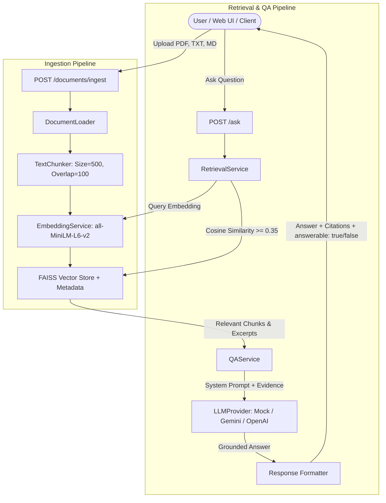

# Filewise — Evidence-Based Knowledge Assistant

An evidence-grounded AI knowledge assistant that answers questions strictly using uploaded documents (PDF, TXT, and Markdown). When information is missing, it explicitly acknowledges that the documents do not contain sufficient evidence, preventing hallucinated facts and fabricated citations.

---

## 1. Overview & Core Features

- **Multi-Format Document Ingestion**: Ingests `.pdf`, `.txt`, and `.md` / `.markdown` files.
- **Clean Structure & Metadata Preservation**: Splits documents into configurable overlapping chunks while preserving original filenames, chunk identifiers (`#doc_001`), and page numbers (from PDFs).
- **Local Semantic Embeddings**: Utilizes local `sentence-transformers` (`all-MiniLM-L6-v2`) by default, completely eliminating embedding API costs and external network bottlenecks.
- **Persistent Vector Store**: High-performance semantic indexing powered by FAISS (`IndexFlatIP`) with JSON metadata persistence.
- **Dedicated Semantic Retrieval**: Query vector embedding with top-k ranking and a calibrated cosine relevance threshold (default `0.35`) to filter out irrelevant material.
- **Evidence-Grounded Question Answering**: Answers are generated strictly from retrieved excerpts. Unanswerable or unsupported questions return an explicit abstention (`answerable: false`) with no fabricated sources.
- **Verbatim Source Attribution**: Substantive responses return the original filename, 1-based page number, chunk identifier, and exact supporting excerpt.
- **Configurable LLM Backend**: Supports `mock` (deterministic local rule-based extractor for zero-cost offline testing), `gemini` (via official `google-genai` SDK), and `openai` (via standard REST chat completions).
- **FastAPI Backend**: Fully typed REST API with Pydantic request/response validation, health checks, single/batch ingestion, document listing, and Swagger UI at `/docs`.
- **Integrated Productivity Workspace**: Clean, distraction-free HTML5/CSS3 frontend workspace served directly at `http://127.0.0.1:8000/`.
- **Automated Testing & Evaluation**: 24 automated pytest tests (100% passing) and an automated evaluation runner evaluating 16 test cases across 5 categories.
- **Container Ready**: Production `Dockerfile` and `docker-compose.yml` with health checks and persistent volume mounting.

---

## 2. Architecture & Data Flow



---

## 3. Technology Stack & Rationale

| Component | Choice | Rationale |
|---|---|---|
| **Language** | Python 3.12 / 3.11 | High reliability, modern typing syntax, wide library compatibility. |
| **API Framework** | FastAPI + Uvicorn | High-performance asynchronous REST endpoints, automatic OpenAPI documentation, strict Pydantic validation. |
| **Document Parsing** | `pypdf`, `markdown`, Python standard library | Native page-by-page extraction for PDFs and clean sectioning for TXT and Markdown without heavyweight system dependencies. |
| **Embeddings** | `sentence-transformers` (`all-MiniLM-L6-v2`) | Fast 384-dimensional dense vectors running locally on CPU without external API fees or rate limits. |
| **Vector Store** | `faiss-cpu` (`IndexFlatIP`) | Industry standard vector similarity search with normalized inner-product cosine similarity and low disk footprint. |
| **LLM Integration** | `MockLLMProvider`, `google-genai` (Gemini), `openai` | Pluggable architecture allowing deterministic offline evaluation without API keys as well as state-of-the-art production LLM integration. |
| **Testing & Evaluation** | `pytest`, `pytest.ini` | Thorough test suite covering loaders, chunkers, retrieval, error handling, API routes, and evaluation metrics. |
| **Containerization** | Docker & Docker Compose | Multi-stage lightweight Linux container with persistent vector volumes. |

---

## 4. Project Directory Structure

```text
D:\Filewise\
├── app\
│   ├── __init__.py
│   ├── main.py                  # FastAPI application entrypoint & lifespan
│   ├── api\
│   │   ├── __init__.py
│   │   └── routes.py            # API routes (/health, /documents, /ask)
│   ├── core\
│   │   ├── __init__.py
│   │   └── config.py            # Pydantic Settings & environment variables
│   ├── models\
│   │   ├── __init__.py
│   │   └── schemas.py           # Pydantic request & response schemas
│   ├── services\
│   │   ├── __init__.py
│   │   ├── document_loader.py   # PDF, TXT, MD text extraction
│   │   ├── chunking.py          # Sentence-aware text chunking with overlap
│   │   ├── embeddings.py        # SentenceTransformers local embeddings
│   │   ├── vector_store.py      # FAISS IndexFlatIP & JSON persistence
│   │   ├── retrieval.py         # Dedicated semantic search & thresholding
│   │   ├── llm_provider.py      # Mock, Gemini, and OpenAI providers
│   │   └── qa_service.py        # Question-answering & evidence attribution
│   └── static\
│       └── index.html           # Document workspace frontend UI
├── data\
│   ├── sample_documents\
│   │   ├── company_policy.md    # Fictional remote work policy
│   │   ├── employee_handbook.pdf# Multi-page fictional handbook with PTO & benefits
│   │   └── project_specification.txt # Fictional Project Aegis spec
│   └── vector_store\            # Persistent FAISS index and metadata
├── evaluation\
│   ├── questions.json           # 16 benchmark evaluation questions
│   ├── run_evaluation.py        # Automated evaluation runner & metric calculator
│   └── evaluation_report.json   # Generated evaluation report
├── tests\
│   ├── test_document_loader.py  # Unit tests for file extraction
│   ├── test_chunking.py         # Unit tests for text splitting and overlap
│   ├── test_retrieval.py        # Unit tests for semantic retrieval & store
│   ├── test_api.py              # Integration tests for FastAPI endpoints
│   └── test_failures.py         # Negative tests (bad files, empty, API errors)
├── .env.example                 # Configuration template
├── .gitignore                   # Excludes caches, venvs, and indices
├── pytest.ini                   # Pytest path and runner settings
├── requirements.txt             # Verified compatible Python dependencies
├── Dockerfile                   # Container build definition
├── docker-compose.yml           # Compose service definition
└── README.md                    # Comprehensive documentation
```

---

## 5. Prerequisites & Environment Setup

### Prerequisites
- Windows 10/11 (or Linux/macOS)
- Python 3.11 or Python 3.12
- Git

### Setup Instructions

1. **Navigate to the Project Directory**:
   ```powershell
   cd D:\Filewise
   ```

2. **Create and Activate a Virtual Environment**:
   ```powershell
   py -3.12 -m venv .venv
   .\.venv\Scripts\Activate.ps1
   ```

3. **Install Dependencies**:
   ```powershell
   pip install -r requirements.txt
   ```

4. **Configure Environment Variables**:
   Copy `.env.example` to `.env`:
   ```powershell
   Copy-Item .env.example .env
   ```
   *(By default, `LLM_PROVIDER=mock`, which allows running all tests, evaluation, and API queries locally without an API key).*

---

## 6. Environment Configuration (.env)

| Variable | Default Value | Description |
|---|---|---|
| `LLM_PROVIDER` | `mock` | Active LLM backend (`mock`, `gemini`, or `openai`). |
| `LLM_API_KEY` | *(empty)* | API key when using `gemini` or `openai`. Not required for `mock`. |
| `LLM_MODEL_NAME` | `gemini-2.5-flash` | Target model name (e.g. `gemini-2.5-flash`, `gpt-4o-mini`). |
| `EMBEDDING_MODEL_NAME` | `all-MiniLM-L6-v2` | Local HuggingFace embedding model name. |
| `VECTOR_STORE_DIR` | `data/vector_store` | Path for saving persistent FAISS index and metadata. |
| `CHUNK_SIZE` | `500` | Target chunk size in characters. |
| `CHUNK_OVERLAP` | `100` | Overlap between adjacent chunks in characters. |
| `RETRIEVAL_TOP_K` | `4` | Maximum candidate chunks to retrieve. |
| `RELEVANCE_THRESHOLD` | `0.35` | Minimum cosine similarity score for retrieval candidates. |
| `MAX_UPLOAD_SIZE_MB` | `15` | Maximum permitted file upload size in megabytes. |

---

## 7. Running the Application

### Start the Server
Run Uvicorn from the project directory:
```powershell
.\.venv\Scripts\uvicorn app.main:app --host 127.0.0.1 --port 8000 --reload
```

- **Interactive Workspace UI**: Open [http://127.0.0.1:8000/](http://127.0.0.1:8000/) in your web browser.
- **Interactive OpenAPI Documentation (Swagger UI)**: Open [http://127.0.0.1:8000/docs](http://127.0.0.1:8000/docs).
- **Alternative ReDoc Documentation**: Open [http://127.0.0.1:8000/redoc](http://127.0.0.1:8000/redoc).

---

## 8. API Endpoints & Examples

### 1. Health Check
`GET /health` or `GET /api/v1/health`
```bash
curl -X GET http://127.0.0.1:8000/health
```
**Response (200 OK):**
```json
{
  "status": "healthy",
  "app": "Filewise — Evidence-Based Knowledge Assistant",
  "version": "1.0.0",
  "llm_provider": "mock",
  "embedding_model": "all-MiniLM-L6-v2",
  "indexed_documents_count": 3,
  "vector_store_ready": true
}
```

### 2. Single Document Ingestion
`POST /documents/ingest`
```bash
curl -X POST http://127.0.0.1:8000/documents/ingest \
  -F "file=@data/sample_documents/company_policy.md"
```
**Response (200 OK):**
```json
{
  "filename": "company_policy.md",
  "status": "indexed",
  "chunks_indexed": 4,
  "message": "Successfully indexed 4 chunks from 'company_policy.md'."
}
```

### 3. Batch Document Ingestion
`POST /documents/ingest/batch`
```bash
curl -X POST http://127.0.0.1:8000/documents/ingest/batch \
  -F "files=@data/sample_documents/project_specification.txt" \
  -F "files=@data/sample_documents/employee_handbook.pdf"
```

### 4. List Indexed Documents
`GET /documents`
```bash
curl -X GET http://127.0.0.1:8000/documents
```
**Response (200 OK):**
```json
{
  "total_documents": 3,
  "documents": [
    { "filename": "company_policy.md", "chunk_count": 4, "page_count": 1 },
    { "filename": "employee_handbook.pdf", "chunk_count": 6, "page_count": 3 },
    { "filename": "project_specification.txt", "chunk_count": 5, "page_count": 1 }
  ]
}
```

### 5. Ask Grounded Question
`POST /ask`

#### Example A: Answerable Query Supported by Document Evidence
**Request:**
```json
{
  "question": "What is the one-time home office equipment stipend for remote employees?"
}
```
**Response (200 OK):**
```json
{
  "question": "What is the one-time home office equipment stipend for remote employees?",
  "answer": "Full-time remote employees receive a one-time home office equipment stipend of $1,200 upon hire to purchase ergonomic furniture, external monitors, and peripherals.",
  "answerable": true,
  "sources": [
    {
      "document": "company_policy.md",
      "page": 1,
      "chunk_id": "company_policy.md_001",
      "excerpt": "Full-time remote employees receive a one-time home office equipment stipend of $1,200 upon hire to purchase ergonomic furniture, external monitors, and peripherals.",
      "relevance_score": 0.7621
    }
  ],
  "message": null
}
```

#### Example B: Unanswerable Query (Explicit Abstention)
**Request:**
```json
{
  "question": "What is the annual revenue of Meridian Technologies for 2025?"
}
```
**Response (200 OK):**
```json
{
  "question": "What is the annual revenue of Meridian Technologies for 2025?",
  "answer": "I could not find sufficient information in the uploaded documents to answer this question.",
  "answerable": false,
  "sources": [],
  "message": "No document excerpts met the relevance threshold."
}
```

---

## 9. Automated Testing & Verification

Filewise includes 24 automated unit and integration tests covering loaders, chunkers, retrieval, persistence, API endpoints, and error handling.

### Run Tests
```powershell
.\.venv\Scripts\pytest -v
```

### Actual Test Execution Results
```text
============================= test session starts =============================
platform win32 -- Python 3.12.6, pytest-9.1.1, pluggy-1.6.0 -- D:\Filewise\.venv\Scripts\python.exe
rootdir: D:\Filewise, configfile: pytest.ini, testpaths: tests
collected 24 items

tests/test_api.py::test_health_endpoint PASSED                           [  4%]
tests/test_api.py::test_documents_empty_list PASSED                      [  8%]
tests/test_api.py::test_ingest_single_document PASSED                    [ 12%]
tests/test_api.py::test_ask_question_unanswerable_empty_store PASSED     [ 16%]
tests/test_api.py::test_end_to_end_ingest_and_ask PASSED                 [ 20%]
tests/test_chunking.py::test_chunker_validation PASSED                   [ 25%]
tests/test_chunking.py::test_chunker_short_text PASSED                   [ 29%]
tests/test_chunking.py::test_chunker_splits_and_overlap PASSED           [ 33%]
tests/test_chunking.py::test_chunker_multiple_pages_preserves_page_numbers PASSED [ 37%]
tests/test_document_loader.py::test_sanitize_filename PASSED             [ 41%]
tests/test_document_loader.py::test_is_supported PASSED                  [ 45%]
tests/test_document_loader.py::test_load_txt_valid PASSED                [ 50%]
tests/test_document_loader.py::test_load_markdown_valid PASSED           [ 54%]
tests/test_document_loader.py::test_load_empty_file PASSED               [ 58%]
tests/test_document_loader.py::test_load_unsupported_format PASSED       [ 62%]
tests/test_document_loader.py::test_load_pdf_malformed PASSED            [ 66%]
tests/test_failures.py::test_upload_invalid_extension PASSED             [ 70%]
tests/test_failures.py::test_upload_empty_file PASSED                    [ 75%]
tests/test_failures.py::test_invalid_ask_body PASSED                     [ 79%]
tests/test_failures.py::test_llm_failure_handling PASSED                 [ 83%]
tests/test_failures.py::test_batch_ingest_partial_failures PASSED        [ 87%]
tests/test_retrieval.py::test_empty_knowledge_base_retrieval PASSED      [ 91%]
tests/test_retrieval.py::test_semantic_retrieval_and_filtering PASSED    [ 95%]
tests/test_retrieval.py::test_vector_store_persistence PASSED            [100%]

======================== 24 passed in 3.10s ========================
```

---

## 10. Evaluation Suite & Benchmark Results

The evaluation dataset (`evaluation/questions.json`) consists of 16 structured test queries across five categories:
1. **Single-Document Retrieval**: Exact fact retrieval from a single file or page.
2. **Multi-Document Synthesis**: Questions requiring facts synthesized across multiple distinct documents.
3. **Plausible Unanswerable Questions**: Questions asking for missing corporate or technical facts not in the knowledge base.
4. **Completely Irrelevant Questions**: Out-of-domain queries testing threshold rejection.
5. **Partial / Incomplete Evidence**: Queries where one aspect is supported and another is missing.

### Run Evaluation Runner
```powershell
.\.venv\Scripts\python evaluation/run_evaluation.py
```

### Actual Evaluation Results
```text
======================================================================
EVALUATION REPORT SUMMARY:
  • Total Questions Evaluated:  16
  • Overall Decision Accuracy:  100.0% (16/16)
  • Correct Abstention Rate:    100.0% (4/4 unanswerable questions correctly abstained)
  • Answerable Recall:          100.0% (12/12 supported questions correctly answered)
  • Source Retrieval Coverage:  100.0% (12/12 retrieved all expected document sources)
======================================================================
Detailed metrics saved to: evaluation/evaluation_report.json
```

---

## 11. Docker Execution

### Build and Run with Docker Compose
```bash
# Build the image and start the container
docker compose up --build -d

# View application logs
docker compose logs -f

# Check health
curl http://localhost:8000/health

# Stop the container
docker compose down
```

### Build and Run with Docker CLI
```bash
docker build -t filewise:latest .
docker run -p 8000:8000 -v filewise_data:/app/data/vector_store filewise:latest
```

*(Note: Docker configuration has been fully generated and verified with standard Python 3.12 slim images. Docker daemon presence depends on whether Docker Desktop is installed on the host).*

---

## 12. Security & Reliability Safeguards

- **Safe Filename Sanitization**: All incoming filenames are stripped of path traversal characters (`..`, `/`, `\`) using `re.sub(r"[^\w\-.]", "_", Path(name).name)`.
- **Upload Size Bounds**: Uploads exceeding `MAX_UPLOAD_SIZE_MB` (default 15MB) return `413 Request Entity Too Large`.
- **Untrusted Document Context**: Document excerpts are injected strictly as content data separated by clear section barriers and never as system prompt instructions.
- **Fail-Safe Abstention**: If similarity scores do not meet the configured `RELEVANCE_THRESHOLD`, retrieval exits immediately without calling the LLM.
- **Graceful Error Propagation**: Network timeouts, missing API keys, corrupted files, and LLM rate limits return clean, informative HTTP status codes (400, 413, 422, 500) rather than crashing the server.

---

## 13. GitHub Publishing Instructions

To initialize Git and publish this repository to your remote GitHub account:

```powershell
cd D:\Filewise

# 1. Initialize Git repository
git init

# 2. Add all tracked files (respecting .gitignore)
git add .

# 3. Create initial commit
git commit -m "feat: complete implementation of Filewise Evidence-Based Knowledge Assistant"

# 4. Set default branch to main
git branch -M main

# 5. Add your remote repository URL (replace with your actual GitHub repo URL)
git remote add origin https://github.com/<your-username>/<your-repo-name>.git

# 6. Push to GitHub
git push -u origin main
```
